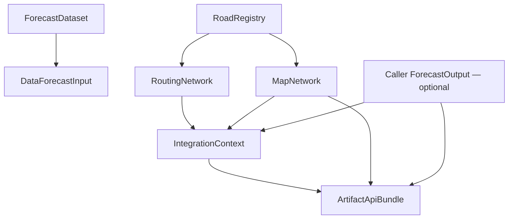

# VietSafe Integration handoff — INT-07

Audit date: 2026-10-11. **PASS WITH BLOCKERS** for contract-only/offline work.
No draft is promoted to stable. No runtime approval is implied by this document.

## Scope and verified baseline

Remote `integration/06b-contract-e2e` was verified at
`2819d683b0a15f92b7c332cbb4b553592a8f919f`, message
`test(integration): add contract end-to-end harness`. Local baseline was clean.
INT-07 branch: `integration/07-quality-handoff`, directly from that commit.

### Ancestry and change audit

Each row has exactly the preceding row as its sole parent (INT-03A starts at
Data-07 `af65447bdc34e7264e00c7174e6f3540c888ec20`). Remote branch heads match.
`git diff-tree` for all six commits found **zero paths outside**
`backend/vietsafe/integration/` and `backend/tests/integration/`.
No Data, core Forecast/Routing, web/API, service or frontend change entered this
Integration chain. This is branch ancestry, not a claim that main contains it.

| Branch | HEAD | Changed files |
| --- | --- | ---: |
| integration/03a-forecast-contracts | c635970e25cc57694b9cd4472a719b59abf914b6 | 9 |
| integration/04a-routing-network-contract | d32af033b35f8a7d45aa27770e545b03ea64b47b | 5 |
| integration/05a-map-network-contract | 7ab37546538e35394125570256d7a9312b6ef4ae | 5 |
| integration/05b-context-guard | b4214939d86cef3d0d0f600aa55f7982a42881a8 | 5 |
| integration/06a-api-contract | 2a77c295662753c805ab915780e80180ce2002fa | 5 |
| integration/06b-contract-e2e | 2819d683b0a15f92b7c332cbb4b553592a8f919f | 4 |

## Existing foundation and entry points

Data-01 through Data-07 are present on the baseline: contract/schema, registry,
offline source adapters, alignment, features/dataset and quality validation.
Completion of those tasks is not a production data-source or model certification.



Public functions, relative to `vietsafe.integration`:

| Module/function | Input → output | Boundary |
| --- | --- | --- |
| data_forecast.build_forecast_input | Data ForecastDataset / dict + sample_index → DataForecastInput | Removes targets/labels; validates inference shape |
| data_forecast.normalize_forecast_output | Caller metadata/results + explicit network/scope → ForecastOutput | Adds UNAVAILABLE status-only rows for omitted requested roads; no metrics invented |
| registry_routing.build_routing_network | RoadRegistry / public dict → RoutingNetwork | Data model revalidation, endpoints/directionality |
| registry_map.build_map_network | RoadRegistry / public dict → MapNetwork | Canonical geometry, minimal allowlist |
| context_guard.build_integration_context | mode + Map + Routing + optional forecasts → IntegrationContext | Exact Map/Routing scope; Forecast subset and set consistency |
| api_projection.build_artifact_api_bundle | Context + Map + exact forecast set + generated_at → ArtifactApiBundle | Binds actual artifacts to context summaries/checksums |
| end_to_end.run_contract_pipeline | RoadRegistry + mode + generated_at + optional forecasts → frozen ContractPipelineResult | Calls the above builders; returns typed artifacts, no IO |

`ForecastProvider` is only a Protocol, not a registered implementation. The E2E
harness does not call it and does not train, predict or run a route solver.

## Contract inventory

All six contracts have `contract_status=draft`. Full fields/validators are in the
named Python modules; no new field or risk semantics is approved by this handoff.

| Contract / schema | Identity and network | Time / horizons | Allowed / forbidden | Producer → expected consumer; runtime status |
| --- | --- | --- | --- | --- |
| DataForecastInput / vietsafe.data-forecast-input.v1 | (network_version, road_id); graph and tensor road order must agree | issue_time, history_timestamps, feature_as_of; 30m grid; +30/+60 | X/X_mask, feature metadata and road graph allowed; y/labels/target metadata forbidden | build_forecast_input → future Forecast provider; offline draft |
| ForecastOutput / vietsafe.forecast-output.v1 | (network_version, road_id); rows unique; explicit prediction scope | issue_time, issued_at, forecast_time; artifact +30/+60, demo 0/+15/+30/+45/+60 | Declared metrics, statuses/reasons and exact coverage; no extra metric/raw input | Caller/provider results → Context/API, future approved routing adapter; provider not connected |
| RoutingNetwork / vietsafe.routing-network.v1 | (network_version, road_id); arc key additionally travel_from/travel_to; uniform network | No time/horizon fields | Nodes, directed travel arcs, length_km, outgoing index, registry checksum; no risk/cost/closure/route result | Registry adapter → future Routing owner adapter; topology draft only |
| MapNetwork / vietsafe.map-network.v1 | (network_version, road_id); one entry per registry road | No time/horizon fields | Name, canonical geometry, directionality, registry checksum; no source_id/provenance/ML/route fields | Registry adapter → Context/API, future Map consumer; offline draft |
| IntegrationContext / vietsafe.integration-context.v1 | One explicit mode/network; Map scope exact with deduplicated Routing road IDs | Forecast summary times; common issue/model, unique sorted horizons | Artifact summaries/checksums and coverage; no prediction rows/tensor/route costs | Context guard → API projection/backend owner; consistency only |
| ArtifactApiBundle / vietsafe.artifact-api-bundle.v1 | Uniform network; full Map scope, Forecast subset by identity | caller generated_at plus untouched Forecast times; explicit available horizons | Minimal Map presentation and validated Forecast envelopes, source hashes; no ML/routing internals/routes | API projection → future Backend/Frontend; no endpoint |

All support `to_dict()` (detached), `to_json()` (canonical compact sorted-key
UTF-8, finite JSON only) and `checksum()` (SHA-256 of canonical content). No
checksum replaces business identity. RoadRegistry exposes its checksum property;
Integration contracts expose a checksum method.

### Checksum and order limits

- Map roads sort by road_id; Routing arcs sort by (road_id, travel_from, travel_to),
  nodes sort by node ID. Registry insertion order is irrelevant to these outputs.
- Context/API forecast lists sort by horizon. Map/Routing registry checksums must
  match. API projection checks the actual Map and complete Forecast summaries,
  not just their separate schema validity; missing/extra artifacts fail.
- ForecastOutput retains caller row and output_fields order. Reordering those
  arrays changes canonical content and checksum by design. Tensor and graph order
  is also meaningful. Order independence applies only where a builder explicitly
  canonicalizes order, not arbitrarily permuted serialized arrays.
- A raw summary cannot prove the existence/authenticity of its source artifacts.
  Context cannot revalidate omitted Routing geometry from a checksum; API cannot
  reconstruct the full Map/Context from reduced presentation. Use the builders
  with actual artifacts. No cryptographic signing or source attestation is claimed.
- Validators preserve zero, reject NaN/Infinity/bool numeric values, and keep
  null distinct from absent. Frozen contracts store detached JSON. E2E returns
  frozen typed artifacts and a tuple of forecasts.

## Identity, network and graph semantics

Every cross-artifact identity is `(network_version, road_id)`. IDs are opaque.
No Integration code parses HN/OSM IDs to infer mode, topology or identity, joins
by name, or silently intersects incompatible networks. Network mismatches use
NETWORK_VERSION_MISMATCH when both versions are meaningful; absent/malformed
versions can fail INVALID_CONTRACT first.

`sample_index` chooses a sample inside one dataset, not a road join. Tensor axes,
graph adjacency indices and Routing outgoing arc indices are internal indexing
validated against explicit IDs; they are not cross-artifact business identities.

| Representation | Nodes / entries | Edges / geometry | Prohibited reuse |
| --- | --- | --- | --- |
| Data/Forecast graph | Road-as-node; explicit road_ids axis | Raw travel-continuity adjacency, no self loops, U-turns allowed by current graph policy | Never use this adjacency as Routing topology |
| RoutingNetwork | Junction-as-node | Directed travel arcs using registry endpoints | No Forecast graph imports/calls in registry_routing/routing_contracts |
| MapNetwork | Canonical road entries | Canonical [lat, lon] polylines | Never reconstruct Map from directed travel arcs |

| Registry directionality | Routing | Map/API |
| --- | --- | --- |
| forward | A → B, canonical full polyline | Canonical geometry |
| reverse | B → A, entire polyline reversed | Canonical geometry, never reversed |
| both | Two opposite arcs, same road_id | One road entry |

OSM directional IDs are retained as Data supplies them. No reverse arc is added
unless directionality calls for it. Routing rejects self-loop segments; it is not
a complete road-navigation/turn-restriction engine. Map/Routing have no mode field:
mode is caller-supplied and cannot be independently inferred/certified from IDs.

## Time, feature and missing semantics

| Field | Meaning | Enforced / not implied |
| --- | --- | --- |
| issue_time | End of input history, T | Artifact 30-minute UTC bin; history must end at T |
| forecast_time | T + horizon | Exact relation checked by ForecastOutput |
| issued_at | Producer publication timestamp | Canonical UTC; not substituted for issue_time |
| generated_at | Caller payload-creation timestamp | Required canonical UTC; never generated from current time |

Canonical timestamps: `YYYY-MM-DDTHH:MM:SSZ`. Forecast set shares network, mode,
issue_time and model_version; issued_at may differ. No stale TTL, latency policy,
or ordering requirement between generated_at and issued_at is invented.

V1 `features-v1`, in exact order:

| Feature | Unit |
| --- | --- |
| precipitation_rate_mm_h | mm/h |
| rain_30m_mm | mm |
| rain_1h_mm | mm |
| rain_3h_mm | mm |
| soil_moisture | m3/m3 |
| elevation_m | m |

Dataset timestep is 30 minutes. Data default lookback is **L=6**, T−150m, T−120m,
T−90m, T−60m, T−30m, T. X/X_mask shape is L × N × 6. The current validator permits
other positive lookbacks; it does not claim that a real model accepts them.
Artifact horizon_steps=1/2 means +30/+60. +15/+45 are rejected in artifact mode.
Demo ForecastOutput separately permits 0/15/30/45/60. No artifact `/15` indexing.

Missing input: null with mask false; finite value (including 0) with mask true.
Integration does no imputation, interpolation or scaling. Output statuses:
OK requires all declared outputs non-null; non-OK requires reason_code and can
retain absent/null declared metrics. Coverage must equal actual status counts.
Partial/empty explicit Forecast scopes are accepted by Context/API without
synthesizing predictions. `validate_scope` requires exact rows for the requested
scope; `normalize_forecast_output` explicitly fills omissions with UNAVAILABLE
status-only rows. Neither makes missing roads safe. No Routing policy is set.

### Forecast output allowlist

Current `METRICS`: **flood_risk, speed_km_h, risk, label**. Numeric metrics must be
finite, label must be a nonempty string when present/non-null. A producer declares
its subset in output_fields; undeclared metrics fail. No risk range, probability
calibration or business unit is established merely by these names.

**flood_depth_cm is NOT supported/approved.** If Forecast chooses it or any new
field, update ForecastOutput contract, validation, tests and API presentation
before runtime integration. INT-07 adds no such field and chooses no policy.

## Quality gate evidence and audit coverage

Fresh baseline runs: Data **304 PASS**, Integration **181 PASS** (485 relevant).
INT-07 adds two meaningful gates: executable handoff examples/source bindings and
explicit rejection of the discussed unapproved flood_depth_cm field. Final:
Data **304 PASS**, Integration **183 PASS** (487 relevant), diff check PASS.
No production code changes were necessary; no architecture layer was added.
Optional full backend suite was not run: required Data/Integration gates passed;
legacy runtime behavior was inspected read-only and remains owner work.

From `backend`:

```sh
PYTHONDONTWRITEBYTECODE=1 python -m unittest discover -s tests/data -t . -v
PYTHONDONTWRITEBYTECODE=1 python -m unittest discover -s tests/integration -t . -v
```

| Gate | Evidence in backend/tests/integration | Result / limits |
| --- | --- | --- |
| A branch/change | Parent SHA and per-commit path audit above | PASS; no history rewrite |
| B inventory | Six typed validators + this inventory | Draft retained |
| C identity | test_data_forecast independent order, context scope, E2E reversed producer order | PASS; internal tensor indices distinguished |
| D network | test_contracts, test_registry_map/routing, context_guard, api_projection, E2E mismatch | PASS; no fallback/intersection |
| E time | history continuity/bin, publication delay, generated_at preservation tests | PASS; TTL not selected |
| F horizon | contract + context + E2E unsupported/duplicate tests | PASS; explicit horizons |
| G null/zero | masks, API four statuses, E2E partial/zero/null tests | PASS; no routing interpretation |
| H output fields | allowlist tests + test_quality_handoff unapproved field | PASS; flood_depth_cm rejected |
| I graph | registry_routing import safety/no graph or solver calls | PASS; Data graph imports elsewhere are model-neutral |
| J direction | registry/map/routing and E2E full-polyline tests | PASS; both and reverse differ by consumer |
| K leakage | recursive E2E forbidden keys; API nested extra-field rejection; input strips target markers | PASS; declared Forecast label is not training labels |
| L import/offline | fresh-process audit hooks across adapters/contracts/E2E; socket/urlopen/runtime patches | PASS; Data model imports allowed, side effects blocked |
| M errors | inventory below, structured error/code assertions | No code rename/addition |
| N determinism | repeat/reorder tests across all artifacts | PASS within documented array-order semantics |
| O immutability | deep input snapshots, detached exports, frozen contract/E2E tests | PASS via validated builders |
| P scientific limits | explicit limitations below | No accuracy/production claim |
| Q Data boundary | feature shape/units/masks tests and validated L=6 example | No model compatibility claimed |

### Read-only findings outside Integration

`core/forecast.py` explicitly describes `spatial-rule-demo-1.0` as a rule-based
demo, not trained T-GCN, and returns `speed` (not the draft `speed_km_h`).
`core/routing.py` contains legacy thresholds/penalties and `horizon // 15` summary
indexing; `frontend/js/map.js` uses `state.horizon / 15` and risk color thresholds.
These are existing demo-runtime assumptions, **not approved artifact policies**.
No such mapping is imported/called by Integration. They were not modified; owners
must address them explicitly before wiring artifact mode. Tests do not establish
legacy-runtime suitability for the new contracts.

## Error code inventory

| Code | Meaning | Actual use | Consumer expectation |
| --- | --- | --- | --- |
| INVALID_CONTRACT | Malformed/unsupported structure or inconsistent artifacts | All validators; mode/checksum/scope/issue/model mismatch | Reject; show structured boundary error, no fallback |
| NETWORK_VERSION_MISMATCH | Incompatible nonempty versions | Data graph/input, registry adapters, Context/API, validate_scope | Reject cross-network join |
| UNKNOWN_ROAD | Road outside allowed scope | Output normalization/scope, Context Routing/Forecast, API | Reject; never silently intersect |
| FEATURE_SCHEMA_MISMATCH | V1 feature version/order/units differ | DataForecastInput validator | Obtain compatible features/model interface |
| UNSUPPORTED_HORIZON | Invalid horizon for mode | Data input/output validation; summaries reuse semantics | Request explicitly supported horizon, no interpolation |
| MISSING_INPUT | Inference sample unavailable or explicit expected rows absent | build_forecast_input, ForecastOutput.validate_scope; also row status | Distinguish boundary failure from producer row status |
| UNAVAILABLE | Reserved boundary code; output row status/reason in normalization | CODES accepts it, no current boundary raise site | No automatic retry/routing policy defined |
| STALE | Reserved boundary code; producer row status | CODES accepts it, no current boundary raise site | No TTL/routing policy defined |

No MODE_MISMATCH code exists: mode mismatch uses INVALID_CONTRACT. Missing Routing
roads use INVALID_CONTRACT; extra Routing roads use UNKNOWN_ROAD. These are
intentional distinctions, not renamed in INT-07. Error serialization contains
code/message/optional path, not a traceback. No critical inconsistency found.

## Scientific/security boundaries

This foundation does NOT claim GPM is accurate road-level urban nowcast, SMAP is
road-level soil measurement, synthetic ForecastOutput is real prediction, contract
E2E proves model accuracy, risk is calibrated probability, API contract is a
production API, or the current rule forecast is T-GCN. Synthetic fixtures prove
contract compatibility only. Production source validation, target labels, model
training/evaluation/calibration and operational safety remain separate work.
No live Overpass/NASA requests or server were used by regression tests. GitHub
read/publish operations are administrative task actions, not artifact runtime IO.

## BLOCKED OWNER DECISIONS

| Owner | Decisions required before runtime |
| --- | --- |
| FORECAST TEAM | Predicted target/output; units/scale; actual model/provider; acceptance of all six V1 features; missing/mask behavior; final +30/+60 confirmation; final output fields; production status semantics; stale TTL and who decides staleness; model_version example |
| ROUTING TEAM | Forecast field used and scale interpretation; separate MISSING_INPUT, UNAVAILABLE and STALE policies; risk penalty; closure/block policy and source (Forecast versus incident/report) |
| BACKEND/API TEAM | Endpoint ownership; runtime mode selection; caching; generated_at ownership; deployment/runtime wiring |
| ALL TEAMS | Confirm opaque (network_version, road_id); issue_time/forecast_time/issued_at/generated_at definitions; exchange concrete compatible input/output examples |

No owner decision is inferred from existing demo constants. Request one real
model input and OK/missing/unavailable outputs, with units, model_version and
explicit scope. Runtime adapter work is blocked until owners approve semantics.

## Readiness matrix

| Component | Status | Ready for | Blocked by | Owner |
| --- | --- | --- | --- | --- |
| Data Module | READY-OFFLINE | Offline dataset/artifact workflow | Production source coverage/validation | Data |
| DataForecastInput | READY-DRAFT | Provider interface review | Forecast input/target/mask semantics | Forecast |
| ForecastOutput | READY-DRAFT | Validated caller outputs | Actual provider, final fields/scale/statuses | Forecast |
| RoutingNetwork | READY-DRAFT | Topology adapter input | Risk/unknown/stale/closure policy | Routing |
| MapNetwork | READY-DRAFT | Canonical presentation | Approved runtime endpoint/wiring | Map/Backend |
| IntegrationContext | READY-DRAFT | Offline consistency checks | Production artifact providers | Integration |
| ArtifactApiBundle | READY-DRAFT | Presentation contract | Backend/API owner approval | Backend |
| Contract E2E | READY-OFFLINE | Compatibility regression | Does not prove model accuracy/runtime operation | Integration |
| Runtime Forecast → Routing | BLOCKED | No runtime activation | Owner policies above | Forecast + Routing |

## Next integration sequence (proposal only)

1. Owners approve target, input/output formats, versions, identity/time and policy.
2. If fields change, revise/version contracts and their tests/API presentation first.
3. Forecast owner implements a provider and validates six-feature/mask compatibility
   and scientific accuracy separately; retain explicit network/scope/time/horizons.
4. Routing owner approves mapping of outputs/statuses/closures before any adapter.
5. Backend/API owner approves endpoint, mode/caching and deployment design; only
   then wire the provider/adapter and frontend under separate authorized tasks.
6. Run contract regressions plus owner-approved runtime acceptance tests before release.

No step in this proposed sequence is implemented by INT-07.

## Validated payload examples

The following six complete JSON objects are synthetic structural examples, not
production observations or predictions. The one-road graph is built from a
synthetic registry; feature-row hashes identify synthetic example values, not
external measurements. Graph and artifact hashes are computed from actual example
objects. Examples A–D/E/F are individually validated; E/F use no forecasts to
keep presentation small. Tests additionally bind B/C/D to that example network
through the context and API builders. An OK `risk: 0` below is only a fixture
value, not a scientific scale or a declaration that the road is safe.

### A. DataForecastInput structural example

```json
{"X":[[[0,null,null,null,null,8]],[[0,null,null,null,null,8]],[[0,null,null,null,null,8]],[[0,null,null,null,null,8]],[[0,null,null,null,null,8]],[[0,null,null,null,null,8]]],"X_mask":[[[true,false,false,false,false,true]],[[true,false,false,false,false,true]],[[true,false,false,false,false,true]],[[true,false,false,false,false,true]],[[true,false,false,false,false,true]],[[true,false,false,false,false,true]]],"contract_status":"draft","feature_as_of":[["2026-10-08T00:00:00Z"],["2026-10-08T00:30:00Z"],["2026-10-08T01:00:00Z"],["2026-10-08T01:30:00Z"],["2026-10-08T02:00:00Z"],["2026-10-08T02:30:00Z"]],"feature_names":["precipitation_rate_mm_h","rain_30m_mm","rain_1h_mm","rain_3h_mm","soil_moisture","elevation_m"],"feature_row_checksums":[["450be19483b746199f52c8c051cf9c9903d3d0ff50c4e1bbad0ac8277fb441b7"],["0600f4a83c07afa7095a4785738962148e8ef2eacf02c4e5e6a00b72e841d89d"],["41bda4587d36bb4a09e0528f69e75a103a74149095c45ef1035699e53f35fc40"],["6765373027d7e91f2b628fa27491b301f96506d6781f40d2cca8ee9fd09f39ea"],["754c5c2a14e9649c94d3f2a541331fc1d907b9d4b641b677ae9f8239de18b4b6"],["99e878c928092c65626b85ee0638dbbcffb319d1c6e353fcacf07eb3b10273eb"]],"feature_units":["mm/h","mm","mm","mm","m3/m3","m"],"feature_version":"features-v1","graph":{"adjacency":[[0]],"directed_edges":[],"graph_version":"road-connectivity-v1","network_version":"test-v1","policy":"raw-travel-continuity-no-self-loops-uturns-allowed-v1","registry_checksum":"5d3255e1bcd79841942bd052c3226639f84701a187df0f593317f56efa773f58","road_ids":["HN-001"]},"graph_checksum":"f7f319409d2810e7d34e12a1103fcc1d2bd7c2288c5fd915b8cc237b917f48a2","history_timestamps":["2026-10-08T00:00:00Z","2026-10-08T00:30:00Z","2026-10-08T01:00:00Z","2026-10-08T01:30:00Z","2026-10-08T02:00:00Z","2026-10-08T02:30:00Z"],"horizon_minutes":30,"horizon_steps":1,"issue_time":"2026-10-08T02:30:00Z","lookback_steps":6,"mode":"artifact","network_version":"test-v1","road_ids":["HN-001"],"schema":"vietsafe.data-forecast-input.v1","source_schema":"vietsafe.forecast-dataset.v1","timestep_minutes":30}
```

### B. ForecastOutput OK example

```json
{"contract_status":"draft","coverage":{"missing_input":0,"predicted":1,"stale":0,"total":1,"unavailable":0},"forecast_time":"2026-10-08T03:00:00Z","horizon_minutes":30,"issue_time":"2026-10-08T02:30:00Z","issued_at":"2026-10-08T02:31:00Z","mode":"artifact","model_version":"SYNTHETIC-HANDOFF-ONLY","network_version":"test-v1","output_fields":["risk"],"roads":[{"risk":0,"road_id":"HN-001","status":"OK"}],"schema":"vietsafe.forecast-output.v1"}
```

### C. ForecastOutput MISSING_INPUT example

```json
{"contract_status":"draft","coverage":{"missing_input":1,"predicted":0,"stale":0,"total":1,"unavailable":0},"forecast_time":"2026-10-08T03:30:00Z","horizon_minutes":60,"issue_time":"2026-10-08T02:30:00Z","issued_at":"2026-10-08T02:31:00Z","mode":"artifact","model_version":"SYNTHETIC-HANDOFF-ONLY","network_version":"test-v1","output_fields":["risk"],"roads":[{"reason_code":"SYNTHETIC_MISSING_INPUT","risk":null,"road_id":"HN-001","status":"MISSING_INPUT"}],"schema":"vietsafe.forecast-output.v1"}
```

### D. ForecastOutput UNAVAILABLE example

```json
{"contract_status":"draft","coverage":{"missing_input":0,"predicted":0,"stale":0,"total":1,"unavailable":1},"forecast_time":"2026-10-08T03:00:00Z","horizon_minutes":30,"issue_time":"2026-10-08T02:30:00Z","issued_at":"2026-10-08T02:31:00Z","mode":"artifact","model_version":"SYNTHETIC-HANDOFF-ONLY","network_version":"test-v1","output_fields":["risk"],"roads":[{"reason_code":"SYNTHETIC_UNAVAILABLE","risk":null,"road_id":"HN-001","status":"UNAVAILABLE"}],"schema":"vietsafe.forecast-output.v1"}
```

### E. IntegrationContext summary example

```json
{"artifacts":{"forecasts":[],"map_network":{"checksum":"72ef7042422d48ab455f35d3bea4cb4af0778de0b71f357caa81f98274699075","registry_checksum":"5d3255e1bcd79841942bd052c3226639f84701a187df0f593317f56efa773f58","schema":"vietsafe.map-network.v1"},"routing_network":{"checksum":"e6ad85ba1f0bae216596bcd503f97f14c0fb0ae08553af1bb409b70ccafffc50","registry_checksum":"5d3255e1bcd79841942bd052c3226639f84701a187df0f593317f56efa773f58","schema":"vietsafe.routing-network.v1"}},"available_horizons_minutes":[],"contract_status":"draft","mode":"artifact","network_version":"test-v1","road_ids":["HN-001"],"schema":"vietsafe.integration-context.v1"}
```

### F. ArtifactApiBundle structural example

```json
{"available_horizons_minutes":[],"contract_status":"draft","forecasts":[],"generated_at":"2026-10-08T04:12:34Z","mode":"artifact","network":{"coordinate_order":"lat_lon","network_version":"test-v1","roads":[{"directionality":"forward","geometry":[[21.0,105.0],[21.1,105.2],[21.2,105.3],[21.3,105.4]],"name":"Test","road_id":"HN-001"}],"schema":"vietsafe.map-network.v1"},"network_version":"test-v1","schema":"vietsafe.artifact-api-bundle.v1","source_checksums":{"forecasts":{},"integration_context":"1746514c7abe2b7cd0ad56e5a6c010c210fda2ad6da96070f23283daf6d4b452","map_network":"72ef7042422d48ab455f35d3bea4cb4af0778de0b71f357caa81f98274699075"}}
```
