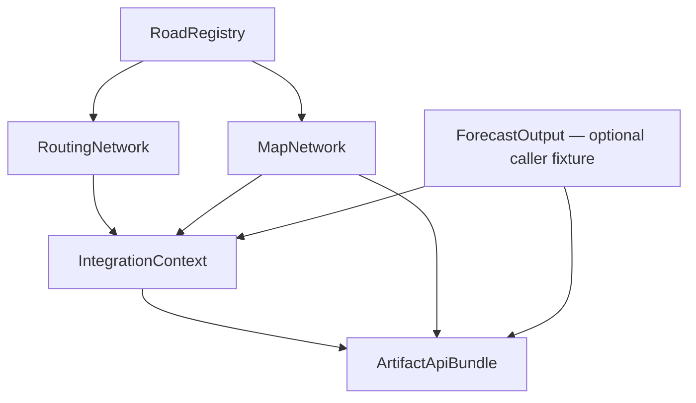

# VietSafe contract-only Integration foundation

## Current phase — INT-07 quality gate and handoff

See [INTEGRATION_HANDOFF.md](INTEGRATION_HANDOFF.md) for the contract inventory,
validated payload examples, ancestry audit, readiness matrix and owner decisions.
Latest quality gate: **PASS WITH BLOCKERS**; 304 Data and 183 Integration tests.
This remains **contract-only / offline**, not a production API or runtime system.
Forecast target/units/provider/missing semantics, Routing risk/status/closure
policies and Backend endpoint/mode ownership must be approved before runtime work.
The task sections below retain implementation history; the handoff is the entry
point for cross-team integration planning.

**DRAFT / PROVISIONAL — FORECAST OWNER APPROVAL STILL REQUIRED.**
This is a contract skeleton, validator, serializer and offline projection adapter.
It is not a Forecast implementation and does not complete INT-03.

Data ForecastDataset → DataForecastInput → [future ForecastProvider] → ForecastOutput

There is no compatible artifact model/provider, approved production target,
trained T-GCN, runtime/Routing/API/Map integration or prediction generation here.
The existing `core.forecast.forecast(road, current, neighbor_speed, rain, horizon)`
cannot consume this input directly. No runtime module is imported or modified.
Only Python standard library and public Data metadata/serialization are used.

## Public API

- `contracts.DataForecastInput(payload)` / `.from_dict(payload)` validates a draft
  inference request. `ForecastOutput` and `ForecastRoadResult` work the same way.
- `data_forecast.build_forecast_input(dataset, sample_index=0)` accepts the current
  public ForecastDataset object or its serialized dict. Selects one sample within
  that dataset; this is not an index join between independent artifacts.
- `data_forecast.normalize_forecast_output(metadata, road_results, *,
  network_version, road_ids)` wraps caller-supplied results. It checks the explicit
  prediction scope and inserts only UNAVAILABLE status rows for omitted roads.
  It never calculates metrics, chooses a provider, generates timestamps or calls
  a model. Test metric values are synthetic contract examples, not predictions.
- `ForecastOutput.validate_scope(network_version, road_ids)` validates an output
  against an external scope. Standalone serialization cannot know that scope.
- `validate_network_match(expected, actual)` rejects mismatches even when road IDs
  coincide. `ForecastProvider` is a typing Protocol only, not instantiated/registered.

Models store validated canonical JSON in frozen dataclasses: nested caller
containers cannot mutate them. `to_dict()` returns a fresh copy; `to_json()` is
sorted-key, compact UTF-8 JSON with a trailing newline and allow_nan=False.
`checksum()` is SHA-256 of those exact UTF-8 bytes, matching Data canonicalization.
No current time, random ID, file write or path is generated automatically.

## DataForecastInput v1

Schema `vietsafe.data-forecast-input.v1`, source schema
`vietsafe.forecast-dataset.v1`, contract_status=draft, mode=artifact.
Public FEATURE_NAMES/FEATURE_UNITS/FEATURE_VERSION are reused from Data:
precipitation_rate_mm_h, rain_30m_mm, rain_1h_mm, rain_3h_mm, soil_moisture,
elevation_m, in that order. Names and units must match exactly. No silent reorder,
extra speed/traffic/incident/free_speed/susceptibility/slope/TWI features.

X and X_mask: L × N × F. IDs unique, graph.road_ids equals road_ids in order.
Identity is (network_version, road_id); IDs are opaque strings. No ID parsing,
name joins, HN-to-OSM mapping or independent-array index joins.
Null requires false mask, finite numeric including zero requires true mask.
Booleans are invalid X values. No fill, scaling, normalization or imputation.
Forecast owner must decide missing-value handling in the future model.

Timestep is 30 minutes; only horizon_steps 1/2 and horizon_minutes 30/60.
UTC timestamps use exactly YYYY-MM-DDTHH:MM:SSZ. History has L consecutive
30-minute bin ends ending at issue_time. feature_as_of and feature_row_checksums
preserve Data's L × N shape; as_of cannot exceed issue_time. This draft deliberately
rejects fractional timestamp spellings. It does not invent a timestamp.

Graph version/network/registry checksum/order/raw binary adjacency/directed edges
and graph checksum are verified structurally. No self loops or normalization are
added. This is the Forecast road-as-node graph, NOT a Routing graph. Without the
source registry/evidence this boundary does not independently prove topology,
row-checksum contents or source truth; use Data quality audit before integration.

The adapter uses an explicit allowlist. It strips y/y_mask, target_name/values,
labels, label_available_at, label_checksums, event_ids and training split metadata.
Unknown nested graph fields are rejected, not copied into inference metadata.
No arbitrary source metadata is forwarded. For inference use a Data dataset built
with require_targets=False; absent/excluded history samples cannot be resurrected.
Only the selected sample and inference-relevant fields are validated; this is not
an audit of unrelated samples, training labels or splits.

## ForecastOutput v1

Schema `vietsafe.forecast-output.v1`, contract_status=draft. Caller provides mode,
network/model versions, issue_time, issued_at, horizon_minutes, forecast_time,
output_fields, roads and coverage. forecast_time = issue_time + horizon_minutes;
issued_at is publication time and may differ. No time is sampled from the clock.

Supported structural metrics: flood_risk, speed_km_h, risk, label. Only declared
output_fields may appear. An OK row has all declared fields non-null and correctly
typed. Producer-unsupported fields are omitted, not invented. Non-OK fields may
be omitted or null; STALE may retain finite old values for presentation. No risk
range/calibration, speed policy or production target is chosen by this skeleton.
No flood_depth/probability/confidence fields are assumed.

Statuses: OK, MISSING_INPUT, UNAVAILABLE, STALE. Non-OK requires nonempty reason_code.
OK means complete output, NOT safe road. Null is never converted to zero.
Coverage (total/predicted/missing_input/unavailable/stale) must equal actual rows,
not merely have the right sum. Duplicate rows and unknown scoped roads reject.
Normalization preserves the explicit caller scope order and adds status-only
UNAVAILABLE rows for omissions. Empty scope requires empty rows and zero coverage.
Staleness is caller-supplied here: no expiry threshold or runtime stale evaluation.

IntegrationContractError serializes code/message/optional path, never traceback.
Codes: INVALID_CONTRACT, NETWORK_VERSION_MISMATCH, UNKNOWN_ROAD,
FEATURE_SCHEMA_MISMATCH, UNSUPPORTED_HORIZON, MISSING_INPUT, UNAVAILABLE, STALE.

## Modes and unresolved owner decisions

Demo runtime stays HN IDs, rule-based and horizons 0/15/30/45/60. Draft output
validation supports those demo horizons but does not wrap/call the demo runtime.
Artifact input uses Data registry IDs (OSM or other Data registry IDs), +30/+60.
No per-road fallback between modes or networks. Matching schema does not certify
that a model is compatible or prediction is accurate.

Still blocking real Forecast implementation: production target/labels, compatible
model and input signature, missing-value policy, output metrics/units/scale,
requested horizons and approval of issue/publication semantics. Routing policies,
expiry thresholds and runtime mode selection are outside INT-03A.

## Offline validation

From backend, suppress optional Python bytecode writes:

```bash
PYTHONDONTWRITEBYTECODE=1 python -m unittest discover -s tests/data -t . -v
PYTHONDONTWRITEBYTECODE=1 python -m unittest discover -s tests/integration -t . -v
```

Tests reuse the existing Data fixture helper without changing it, test nested
label stripping with sentinel values, immutable copies, actual Data interoperability,
shape/order/checksums, masks, publication delay, all statuses and partial coverage.
Socket/HTTP are blocked at entrypoints; a fresh interpreter checks imports for
network/filesystem/DB side effects. No live providers or prediction accuracy tests.

## INT-04A Routing Network Contract

**DRAFT / PROVISIONAL.** `RoadRegistry → RoutingNetwork` is a pure structural
adapter for a future Routing consumer. It does not calculate a route or connect
Forecast. There is no Forecast→Routing adapter, risk mapping, stale/unknown policy,
closure policy, vehicle policy, ETA, route solver integration or runtime/API integration.

Public API:

```python
from vietsafe.integration.registry_routing import build_routing_network
network = build_routing_network(registry, expected_registry_checksum=registry.checksum)
payload = network.to_dict()
```

Input accepts a public Data RoadRegistry or its full serialized dict. Dict roads
must contain the existing RoadSegment fields (including source/name metadata);
they are reconstructed through RoadSegment/RoadRegistry validation. Optional
`registry_checksum` in the dict and/or the keyword expected_registry_checksum are
verified against the canonical RoadRegistry checksum, not raw file bytes. Malformed
Data inputs become IntegrationContractError with INVALID_CONTRACT or, when identified,
NETWORK_VERSION_MISMATCH. Error serialization contains no raw Data traceback/message.
No Data validator is changed. Object inputs are also revalidated without mutation.

Output schema: `vietsafe.routing-network.v1`, contract_status=draft. Fields:
network_version, registry_checksum, nodes, arcs, outgoing, routing_policy.
RoutingArc/ RoutingNetwork accept a payload or `.from_dict(payload)`, are frozen
with canonical JSON storage, and offer detached `.to_dict()`, `.to_json()`, `.checksum()`.
Canonical encoding is sorted keys, compact UTF-8, no NaN, trailing newline; checksum
is SHA-256 of those bytes. No self-referential checksum, timestamps or random keys.

Graph semantics are distinct:

- Forecast graph: **road-as-node**, adjacency describes travel continuity between roads.
- Routing network: **junction-as-node, travel arc-as-edge**, built directly from
  registry endpoint_a/endpoint_b and directionality. No feature adjacency is read.

Nodes are nonempty opaque endpoint IDs, unique and sorted. No node coordinate
records are invented. Road IDs are opaque and never parsed to infer connectivity.
Within a network the arc identity is (road_id, travel_from, travel_to); across
networks it additionally requires network_version. Parallel roads remain separate.

| Registry directionality | Travel arcs | Travel geometry |
| --- | --- | --- |
| forward | endpoint_a → endpoint_b | canonical coordinates |
| reverse | endpoint_b → endpoint_a | entire canonical polyline reversed |
| both | both of the above, same road_id | one polyline per travel direction |

The adapter does not infer direction from OSM f/r ID suffixes. DATA-03 has already
produced separate directed RoadSegments; each forward/reverse segment produces
exactly one arc. Demo both produces two arcs without changing/suffixing road_id.
Geometry remains [latitude, longitude], including every intermediate coordinate.
No snapping, GeoJSON conversion or length recomputation occurs. length_km is copied
exactly and must be finite and positive. Self loops reject rather than disappear.

Arcs are sorted by (road_id, travel_from, travel_to). outgoing[node] contains their
indices within THIS same artifact; it is never a cross-artifact identity. Nodes
with no outgoing arcs have an empty list. Validation checks index contents,
composite uniqueness, network consistency and both-direction pair symmetry.
Unknown fields such as risk/speed/closure/forecast reject in this contract.

routing_policy=`registry-endpoints-directionality-v1-no-turn-restrictions` describes
only topology conversion. It is not a routing cost/product policy. The standalone
contract validates structure; without the source registry it cannot prove a digest
refers to actual source contents or independently confirm an endpoint's physical
location. The adapter ensures geometry direction relative to registry semantics.
Full OSM turn restrictions, barriers and vehicle-specific access remain unresolved;
this artifact is not a production navigation network or route recommendation.

Tests cover four-point reversal, both directions sharing identity, parallel roads,
self-loop rejection, checksum verification, input-order independence, outgoing index,
and the existing local OSM fixture through read_overpass/build_road_network. Socket
and HTTP are blocked in key tests. Fresh-process import tests reject writes/mkdir/DB/
network and ensure neither Forecast graph nor runtime Forecast/Routing was imported.

INT-04B still requires owner decisions on risk semantics, missing/stale behavior
and closure sources/policy. INT-04A does not decide or implement them.

## INT-05A Map Network Contract

**DRAFT / PROVISIONAL.** `RoadRegistry → MapNetwork` projects canonical registry
roads for a future API/Frontend consumer. This is an offline artifact only: no
Forecast→Map, Routing→Map, API endpoint, Frontend integration or runtime mode switch.

Public API:

```python
from vietsafe.integration.registry_map import build_map_network
network = build_map_network(registry, expected_registry_checksum=registry.checksum)
payload = network.to_dict()
```

Accepts RoadRegistry or its full serialized dict; dict roads are reconstructed
through the public Data RoadSegment/RoadRegistry validators. An optional
registry_checksum in the dict and/or expected_registry_checksum argument is checked
against canonical RoadRegistry serialization, not raw file bytes. Invalid Data
inputs become IntegrationContractError (INVALID_CONTRACT, or
NETWORK_VERSION_MISMATCH for mixed network versions). Input is not mutated.

Schema `vietsafe.map-network.v1`, contract_status=draft; required envelope fields:
network_version, registry_checksum, coordinate_order=lat_lon and roads. Each road
has exactly road_id, network_version, name, geometry and directionality. IDs are
opaque; identity is (network_version, road_id). No parsing OSM IDs, name joins,
index joins, renaming or HN→OSM mapping. Roads are unique and sorted by road_id.
The adapter sorts source roads deterministically; a manually constructed contract
with unsorted/duplicate roads rejects rather than silently deduplicating.

Geometry remains canonical [latitude, longitude] from RoadSegment.coordinates.
**Reverse does NOT reverse map geometry.** Forward/reverse/both each produce ONE
map entry per RoadSegment. Both is never expanded into two map entries. Separate
OSM f/r segments keep their original separate road IDs. Travel-direction arrows
would require a future presentation policy, not mutation of this canonical line.

The three structures serve different purposes:

- Forecast graph: road-as-node.
- Routing network: junction-as-node, travel arc-as-edge; reverse geometry is travel ordered.
- Map network: road entries + canonical polylines, independent of travel direction.

MapNetwork is built directly from RoadRegistry, never RoutingNetwork arcs. Using
arcs as its source would duplicate both roads and incorrectly reverse geometry.
RouteOutput travel geometry belongs to a later Routing→Map contract.

No source_id, provenance, labels, tensor, adjacency, grids, feature checksums or
OSM lineage is exposed. No risk/flood_risk/speed/label/forecast/horizon/model_version,
route/ETA/distance/warnings are present; unknown fields reject. The only checksum
in the payload is the source registry checksum; the artifact checksum is a method.

MapRoad and MapNetwork are frozen canonical-JSON models, accepting payloads or
.from_dict(). to_dict() returns a deeply detached copy; to_json()/checksum() use
sorted keys, compact UTF-8, a trailing newline, allow_nan=False and SHA-256. No
current time, random UUID or file path is generated. Finite numeric lat/lon ranges,
at least two points and at least two distinct coordinates are required. Booleans,
NaN/Infinity, empty names/IDs and mixed networks reject. No GeoJSON conversion,
snapping or geometry simplification is performed. Standalone checksum-format
validation does not prove the registry exists; adapter verification requires the
actual source registry or expected checksum. Empty registries remain unsupported.

Tests include four-point forward/reverse/both geometry, order-independent dict and
object inputs, detached state, malformed geometry, duplicate IDs, mixed versions,
the existing offline OSM fixture and 36-road demo registry (not doubled to 72).
Socket/HTTP are blocked at key entrypoints, and a fresh process checks import safety.
No simulation/model/route solver is called. Run the same Data/Integration unittest
commands above; no dependencies or runtime files change.

Forecast→Routing remains blocked on owner risk semantics, missing/stale and closure
policy. Forecast/Map presentation or API contract skeletons may proceed separately
when authorized; this task does not implement them or runtime integration.

## INT-05B Integration Context Guard

**DRAFT / PROVISIONAL**, offline only:

`MapNetwork + RoutingNetwork + optional ForecastOutput(s) → IntegrationContext`

```python
from vietsafe.integration.context_guard import build_integration_context

context = build_integration_context(
    mode="artifact",
    map_network=map_network,
    routing_network=routing_network,
    forecasts=(),  # optional typed ForecastOutput objects or serialized dicts
)
context.to_dict()   # detached containers
context.to_json()   # canonical UTF-8 JSON, sorted keys, compact, finite only
context.checksum()  # SHA-256 of the canonical JSON
```

Map and Routing are required. Their typed contracts or serialized dictionaries
are revalidated with their existing validators. ForecastOutput validation is
reused unchanged, including forecast_time relative to issue_time, supported
horizons and exact per-status coverage. No provider is called.

The `vietsafe.integration-context.v1` summary contains `contract_status=draft`,
explicit `mode` (`demo` or `artifact`), `network_version`, sorted unique nonempty
`road_ids`, `artifacts`, and sorted `available_horizons_minutes` (empty without
forecasts). It contains no tensors, labels, adjacency, predictions or route costs.

Consistency rules:

- Identity is `(network_version, road_id)`; all attached artifacts must share the
  network version. No index join, road-name join, ID parsing or per-road fallback.
- Map supplies the road scope. Routing's road IDs are deduplicated across arcs
  and must match Map exactly. A `both` road has two arcs but one context road ID.
- Map and Routing must share the same registry checksum, preventing two different
  registry snapshots with a reused version string from being combined.
- Map/Routing have no mode field. The caller declares mode; the guard cannot
  independently certify source mode and never guesses it from HN/OSM ID text.
- Forecast mode must equal context mode. Forecast roads must be a subset of the
  context scope. Each output's actual rows form its explicit prediction scope;
  `ForecastOutput.validate_scope` is called for that scope, without weakening its
  requirement for a status row for every road in an explicitly requested scope.
- Partial and empty forecast scopes are accepted as allowed by ForecastOutput.
  Summary `road_ids` and exact `coverage` are retained for each horizon. Roads
  outside that scope have no forecast; they are never synthesized as safe or 0.
  The guard cannot infer a producer's intended scope beyond the supplied rows.
- A forecast set shares mode, network, issue_time and model_version. Horizons
  must be unique. Artifact mode permits +30/+60; demo preserves its existing
  0/+15/+30/+45/+60 contract. `issued_at` can differ and is never used as issue time.

Artifact summaries contain real checksums of the validated inputs. Map/Routing
summaries also retain registry checksum. Forecast summaries retain schema, mode,
network/model versions, issue/issued/forecast times, horizon, explicit road IDs
and coverage. Forecast summaries sort by horizon; reversing input forecast order
preserves context JSON/checksum. Source artifact checksums remain sensitive to
changes in their actual canonical content, including ForecastOutput row order.
No current timestamp or random identifier is generated. Inputs are not mutated;
the context is frozen with detached exports.

Deserializing a context validates summary structure and internal consistency.
A hash alone does not prove possession/authenticity of an artifact: use
`build_integration_context` with actual artifacts to verify compatibility and bind
checksums. Per-status coverage is checked against actual rows by ForecastOutput
at build time; the compact summary does not duplicate all prediction rows.

Errors reuse `IntegrationContractError`: network mismatch uses
`NETWORK_VERSION_MISMATCH`; unknown Routing/Forecast roads use `UNKNOWN_ROAD`;
unsupported horizons use `UNSUPPORTED_HORIZON`; missing Routing roads, mode,
registry snapshot, issue/model, duplicate horizons or malformed contracts use
`INVALID_CONTRACT`. No new error code or runtime policy is introduced.

Tests (from `backend`, offline):

```sh
PYTHONDONTWRITEBYTECODE=1 python -m unittest discover -s tests/data -t . -v
PYTHONDONTWRITEBYTECODE=1 python -m unittest discover -s tests/integration -t . -v
```

The guard does not predict, route, interpret risk, choose closures, serve API,
render frontend, or change canonical/travel geometry. INT-04B Forecast → Routing
remains blocked by owner decisions on risk semantics, unknown/missing, stale and
closure policies. API contract skeleton work can follow separately; runtime
integration remains outside this task.

## INT-06A Artifact API Contract Skeleton

**DRAFT / PROVISIONAL — presentation contract only.**

`MapNetwork + ForecastOutput(s) + IntegrationContext → ArtifactApiBundle`

```python
from vietsafe.integration.api_projection import build_artifact_api_bundle

bundle = build_artifact_api_bundle(
    context=context,
    map_network=map_network,
    forecasts=forecasts,  # exact set attached to context; defaults to ()
    generated_at="2026-10-08T04:12:34Z",  # required caller-supplied UTC timestamp
)
bundle.to_dict()   # deeply detached
bundle.to_json()   # canonical compact UTF-8 JSON, sorted keys, allow_nan=False
bundle.checksum()  # SHA-256
```

Typed contracts and their serialized dictionaries are supported and revalidated.
The schema is `vietsafe.artifact-api-bundle.v1`, `contract_status=draft`. Fields:
`schema`, `contract_status`, `mode`, `network_version`, `generated_at`,
`available_horizons_minutes`, `network`, `forecasts`, `source_checksums`.

Mode and available horizons come from the supplied context. The projection never
infers mode from an ID or uses `/15` array-index horizon semantics. The caller
must provide canonical `YYYY-MM-DDTHH:MM:SSZ` generated_at; it describes payload
creation only. It does not replace or recompute issue_time, issued_at or
forecast_time. There is no current-time lookup or random ID generation.

Before projecting, the function verifies context network and exact road scope
against Map, and compares the full Map summary (schema, actual artifact checksum,
registry checksum). Every supplied forecast is revalidated with ForecastOutput;
network, mode and road membership are checked, then its complete summary,
including actual checksum, times, model, horizon, road IDs and coverage, must
match the corresponding context summary. Missing, extra or duplicate forecasts
are rejected. The supplied context is never silently rebuilt or repaired.

Network presentation uses an explicit allowlist: `schema`, `network_version`,
`coordinate_order`, `roads`; each road exposes only `road_id`, `name`, `geometry`,
`directionality`. Geometry stays canonical `[lat, lon]`, including reverse roads.
Map road order is preserved (sorted road_id). No source_id, provenance, registry
internals, routing arcs/outgoing, feature tensors, adjacency or OSM lineage leaks.

Each forecast preserves the complete validated ForecastOutput public envelope,
including schema/draft status, network/model/mode, issue_time, issued_at, horizon,
forecast_time, output_fields, coverage and roads. The existing validator permits
only road_id, status, optional reason_code and declared metrics in each row.
Rows keep **producer order** and exact values; the projection does not join by
index, normalize risk, create colors/labels, fill null/absent metrics, or treat
missing forecasts as safe. All four statuses remain unchanged. Partial and empty
forecast row scopes remain partial/empty while the Map network retains its full
scope. Frontend presentation policy is a future owner's decision.

Forecast objects sort by horizon, so reversing their input order with identical
generated_at yields identical bundle JSON/checksum. Producer row order remains
part of the source ForecastOutput checksum and is deliberately not rewritten.
Identity is `(network_version, road_id)`, never a checksum, index, name, or parsed
HN/OSM identifier.

`source_checksums` contains the real `integration_context` and `map_network`
checksums plus `forecasts` keyed by decimal horizon strings (e.g. `"30"`, `"60"`).
The raw bundle validator checks schema, allowed fields, mode, UTC time, MapRoad
geometry/identity rules, ForecastOutput semantics, network/mode/scope, common
issue/model, unique sorted horizons, and exact forecast payload checksums. It
rejects route/ETA/distance/vehicle fields, raw model inputs, malformed coverage,
nonfinite metrics and undeclared fields.

Trust boundary: raw bundle deserialization checks structural consistency and
forecast hashes, but cannot recover omitted Map metadata or the entire context
from a hash. Build with actual artifacts to verify source bindings. Routing is
not passed into this projection: its compatibility remains the responsibility of
`build_integration_context`; INT-06A does not independently authenticate a
Routing artifact or make a checksum a proof of origin.

Errors reuse IntegrationContractError: `NETWORK_VERSION_MISMATCH`, `UNKNOWN_ROAD`,
`UNSUPPORTED_HORIZON` from forecast validation, and `INVALID_CONTRACT` for other
mismatches. Inputs are not mutated; bundle storage is frozen and exports detached.

Regression from `backend`:

```sh
PYTHONDONTWRITEBYTECODE=1 python -m unittest discover -s tests/data -t . -v
PYTHONDONTWRITEBYTECODE=1 python -m unittest discover -s tests/integration -t . -v
```

No endpoint, HTTP, DB query, frontend, route calculation, prediction or risk
interpretation is implemented. INT-04B Forecast → Routing remains blocked by
owner policy. Endpoint integration requires backend/API owner agreement in a
separate task; contract-only work can continue without runtime integration.

## INT-06B Contract-only E2E Harness

`run_contract_pipeline` composes existing public builders and typed validators.
This is an offline contract compatibility harness, **not production runtime**.



```python
from vietsafe.integration.end_to_end import run_contract_pipeline

result = run_contract_pipeline(
    registry=registry,  # validated Data RoadRegistry supplied by caller
    mode="artifact",   # explicit, never inferred from an ID
    generated_at="2026-10-08T04:12:34Z",
    forecasts=(),      # or caller-supplied ForecastOutput objects/contract dicts
)
result.routing_network
result.map_network
result.forecasts  # immutable tuple, sorted by horizon
result.context
result.api_bundle.to_json()
```

The result is a frozen dataclass containing immutable typed artifacts. Forecasts
are revalidated and detached before assembly. The harness produces no prediction,
never repairs rejected inputs, and never bypasses Map/Routing/Context/API
validators. No current time, file read/write, CLI or implicit printing is added.
Registry loading remains a caller/test responsibility; generated_at is required.

Tests obtain an actual Data RoadRegistry offline from
`data/fixtures/osm/overpass-small.json` via `read_overpass` and
`build_road_network`, then run every Integration boundary. A second path uses
`load_demo_registry` without simulation: 36 Map roads, 72 travel arcs, 36 context
road IDs. Registry network_version, road IDs and checksum survive the boundaries.
Routing scope compares deduplicated road IDs, not arc counts or list indices.
Identity stays `(network_version, road_id)`, with no name join or ID parsing.

Map and API geometry stay canonical `[lat, lon]`. Routing reverse travel reverses
the entire polyline; `both` creates two travel arcs for one road. Routing arcs
never enter the API payload. Tests separately exercise forward/reverse/both.

`tests/integration/e2e_helpers.py` contains explicitly synthetic **contract
fixtures**, not a trained model or real prediction. +30/+60 outputs cover four
of the OSM fixture's twelve roads, preserving OK risk=0, MISSING_INPUT null,
UNAVAILABLE absent metric and STALE null. API output keeps full Map scope and
partial forecast rows without synthesis. Forecast producer row order is kept;
reversing the forecast-list order and registry insertion order preserves all
artifact checksums. Repeated runs with the same generated_at are deterministic.

Failure tests reject wrong network, unknown road, divergent Routing scope,
tampered context Map/Forecast hashes, issue mismatch, duplicate horizons and
artifact +15/+45. Fault injection at builder boundaries is test-only; no bypass
or tampering hook exists in the harness. Recursive API checks prohibit raw ML
inputs, training labels, grids, routing internals and route-result fields.
Deep snapshots and frozen/detached export checks cover mutation. Import and E2E
checks block network/runtime calls, writes, mkdir and unintended output.

From `backend`:

```sh
PYTHONDONTWRITEBYTECODE=1 python -m unittest tests.integration.test_integration_end_to_end -v
PYTHONDONTWRITEBYTECODE=1 python -m unittest discover -s tests/data -t . -v
PYTHONDONTWRITEBYTECODE=1 python -m unittest discover -s tests/integration -t . -v
```

There is no trained model, real prediction, route solver integration, HTTP
endpoint, frontend integration or production runtime. Contract-only integration
now has E2E validation. INT-04B Forecast → Routing remains blocked by owner
decisions on forecast target/output semantics, risk scale, unknown/missing,
stale and closure policies. Runtime integration requires separate owner approval.
